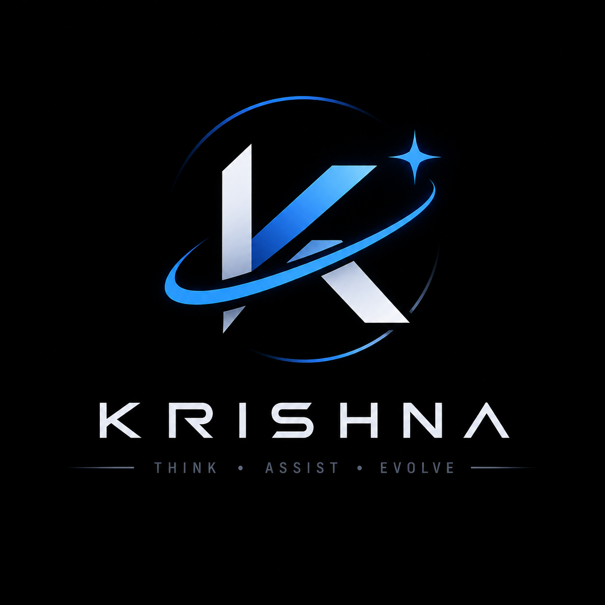

# Krishna — Personal AI Assistant

<p align="center">
  
</p>

**A modular, voice-enabled personal AI assistant built to think, assist, research and execute tasks.**


---

## Overview

## Development Roadmap

Krishna is an actively evolving project. Development progress, upcoming features, and planned improvements are tracked publicly.

**[View the Krishna Development Roadmap](https://github.com/users/JyotiradityaSisodia/projects/2/views/1)**

The roadmap distinguishes completed work, tasks ready for development, ongoing work, and future plans.


**Krishna** is an experimental personal AI assistant designed to go beyond conventional chatbot interactions.

The project explores how multiple AI capabilities can work together within a single assistant: language-model integration, reasoning, memory, voice interaction, research, task planning and device automation.

The long-term vision is to build a practical, extensible assistant that can understand user intent, maintain useful context, assist with complex tasks and interact with connected devices.

Krishna is being developed as a modular system, with an emphasis on extensibility, practical utility and responsible execution.

## Core Capabilities

The repository currently contains implementations and development modules for:

- **AI integration:** Gemini API integration and adapters for local language-model backends.
- **Reasoning and decision-making:** Intent classification, response handling and decision logic.
- **Memory:** Conversation storage, memory retrieval, long-term memory and journaling modules.
- **Voice interaction:** Speech recognition, wake-word handling and audio processing components.
- **Research:** Web retrieval and research-oriented workflows.
- **Task management:** Task planning, progress tracking and execution logic.
- **Automation skills:** Modules for messaging, email, booking and other assistant actions.
- **Desktop interface:** A desktop application built with PySide6.
- **Cloud and device communication:** FastAPI services and a device/task routing framework.
- **Experimental self-improvement:** Backup, review, patching and sandbox-related components.

*These describe capabilities represented in the codebase; individual modules may have different levels of completeness and testing.*

## Architecture

Krishna follows a modular architecture intended to separate intelligence, application logic, interfaces and execution tools.

| Module | Responsibility |
|---|---|
| `app/` | Main application backend and API |
| `brain/` | Reasoning, memory, AI adapters, research and voice modules |
| `core/` | Orchestration, planning, routing and task management |
| `desktop/` | PySide6 desktop application and device interaction |
| `frontend/` | Web interface assets |
| `cloud/` | Cloud API and device/task coordination |
| `skills/` | Higher-level assistant capabilities |
| `tools/` | Browser, messaging, Android and other integrations |
| `self_upgrade/` | Experimental code review and upgrade workflows |
| `android/` | Android-related tooling and integration components |
| `docs/` | Technical specifications and project documentation |

### Conceptual Workflow

```text
                    USER
                      |
             Desktop / Frontend
                      |
                   FastAPI
                      |
              Application Logic
                      |
              AI Orchestration
                      |
          +-----------+-----------+
          |           |           |
       Reasoning    Memory     Research
          |           |           |
          +-----------+-----------+
                      |
             Task / Skill System
                      |
            Tools and Integrations
                      |
          External Services / Devices
```

*This is a conceptual representation of the intended system, not a guarantee that every component is currently connected.*

## Technology Stack

| Technology | Purpose |
|---|---|
| Python | Primary development language |
| FastAPI | Backend APIs |
| PySide6 | Desktop application |
| Google Gemini API | Cloud-based language-model integration |
| llama.cpp | Local model integration |
| Ollama | Alternative local model integration |
| Vosk | Speech recognition |
| Faster-Whisper | Speech-to-text |
| Silero VAD | Voice activity detection |
| HTML, CSS, JavaScript | Frontend interface |

## Project Structure

```text
Krishna/
│
├── android/          # Android integration
├── android_agent/    # Android agent components
├── app/              # Main application backend
├── brain/            # AI and intelligence modules
├── cloud/            # Cloud API and device coordination
├── core/             # Core orchestration and task logic
├── desktop/          # Desktop application
├── docs/             # Technical documentation
├── frontend/         # Frontend assets
├── self_upgrade/     # Experimental self-improvement system
├── skills/           # Assistant skills
├── tools/            # External tools and integrations
│
├── requirements.txt
├── start_krishna.bat
└── README.md
```

## Development Status

Krishna is currently in an experimental development stage.

The repository contains multiple modules exploring AI orchestration, memory management, voice interaction, research, task execution, and desktop integration. However, not every component is fully integrated, independently tested, or production-ready.

### Current Priorities

- Consolidating the AI architecture and backend selection.
- Improving reliability and consistency across modules.
- Refining voice interaction and memory management.
- Strengthening execution safeguards and error handling.
- Standardizing installation and configuration.
- Expanding testing and technical documentation.

Development progress is tracked through the [public project roadmap](https://github.com/users/JyotiradityaSisodia/projects/2/views/1).

**Note:** Krishna is an experimental personal AI assistant and is not currently intended for production use.


## Security

- Never commit API keys, passwords, tokens or personal credentials.
- Keep environment-specific configuration in a local `.env` file.
- Use `.env.example` for non-sensitive configuration templates.
- Review automation permissions before allowing external actions.
- Avoid committing personal conversation data, browser profiles or local model files.

## Running the Project

The installation and configuration process is still being standardized.

The project currently targets Windows development environments. Setup instructions will be expanded as the application architecture and dependency list are consolidated.

Do not assume that every module can currently be launched independently.

## Roadmap

- [x] Initial project structure
- [x] Initial GitHub repository
- [x] Modular AI and application components
- [x] Gemini integration in the core orchestrator
- [x] Initial memory and task-management modules
- [x] Voice-processing components
- [ ] Unified and configurable AI backend
- [ ] Consistent memory architecture
- [ ] Reliable voice-first interaction
- [ ] Improved desktop interface
- [ ] Integration and automated testing
- [ ] Complete installation guide
- [ ] Demonstration video and screenshots

## Project Philosophy

Krishna is built around a simple idea:

> An AI assistant should not merely respond to instructions. It should understand context, help people think, and make useful work easier to accomplish.

The objective is to explore the engineering behind that idea, one reliable component at a time.

---

**Project:** Krishna — Personal AI Assistant  
**Development:** Ongoing  
**Repository:** [GitHub](https://github.com/JyotiradityaSisodia/Krishna-AI)
